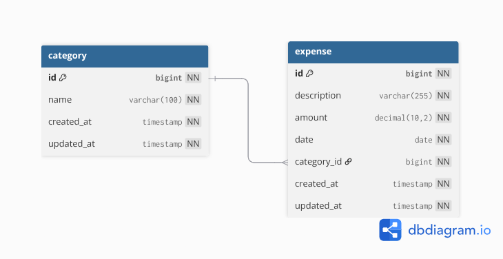

# Expense Tracker API

A REST-ful API designed to manage personal financial expenses and categories. This project is built using Spring Boot and Spring Data JPA, focusing on core CRUD operations and a professional database design.

## Features

- [x] Category Management (CRUD): Add, view, update, and delete spending categories
- [x] Record expenses with details like description, amount and date, linking each to a specific category
- [x] Uses `Decimal(10, 2)` for amount to ensure accurate financial calculations.
- [x] Auditing: Automatic timestamping for creation and last update (`createdAt`, `updateAt`).
- [x] Unit tests (services).
- [x] Intgration tests (controllers).

## Tech Stack

- Language: Java 17
- Framework: Spring Boot 3.2.0
- Data Access: Spring Data JPA
- Database: PostgresSQL
- Testing: JUnit 5, Mockito
- API Documentation: Springdoc OpenAPI (Swagger UI)

## Database Schema

The application uses a normalized database structure consisting of two tables with a One-to-Many relationship (one Category to many Expenses).



## Getting Started

### Prerequisites

- JDK 17 or later
- Maven 3.6+
- PostgresSQL instance running

1. Clone the repository

```bash
git clone https://github.com/SymonMuchemi/expense_tracker_api
cd expense_tracker_api
```

2. Configure the database

```txt
spring.datasource.url=jdbc:postgresql://localhost:5432/expense_tracker_db
spring.datasource.username=your_username
spring.datasource.password=your_password
spring.jpa.hibernate.ddl-auto=update
```

3. Build and Run

Run the application using the Spring Boot Maven plugin:

```bash
./mvnw clean install
./mvnw spring-boot:run
```

### Swagger Documentation:

[http://localhost:8080/swagger-ui/index.html#](http://localhost:8080/swagger-ui/index.html#)
